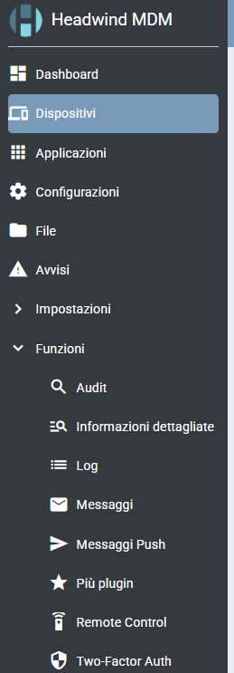
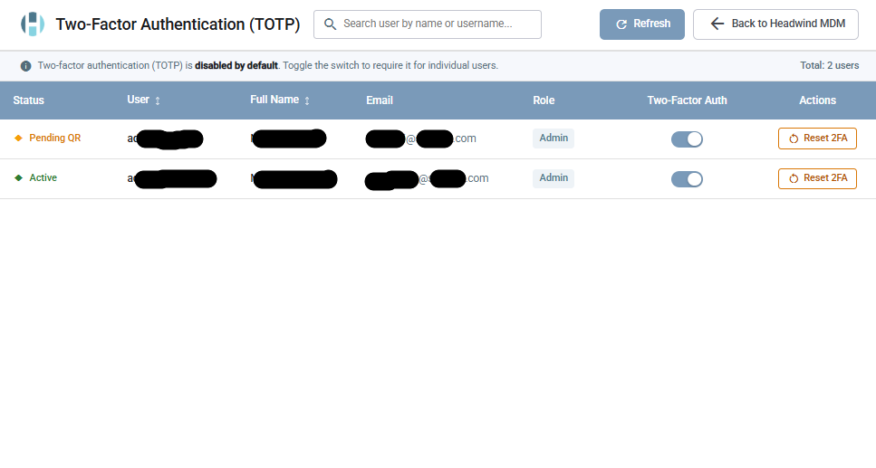
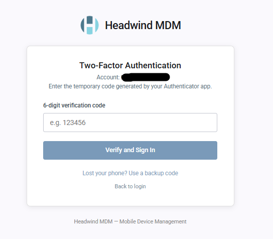

# Headwind MDM - 2FA TOTP Authentication Plugin

[](LICENSE)
[](https://h-mdm.com)
[](https://tools.ietf.org/html/rfc6238)
[](#features)

A modern, non-invasive, open-source **Two-Factor Authentication (2FA / TOTP) Plugin** designed specifically for **Headwind MDM**.

Secures the Headwind MDM administrative web console with industry-standard Time-based One-Time Passwords (TOTP). Compatible with **Google Authenticator, Microsoft Authenticator, Authy, 1Password**, and any standard RFC 6238 authenticator app.

---

## ✨ Features

- **🔌 100% Non-Invasive Drop-In:** Zero modifications to Headwind MDM core source code or `ROOT.war`.
- **⚙️ Integrated into the "Functions" Sidebar Menu:** Adds a dedicated **"Two-Factor Auth"** menu item under the native *Functions* (*Funzioni*) navigation menu in the Headwind MDM console.
- **🎯 Per-User Control (Disabled by Default):** 2FA is **not** forced on everyone. It is disabled by default for all users. Administrators can selectively activate 2FA for specific accounts with a single toggle switch.
- **👥 In-Console User Management Modal:** Administrators can view all Headwind MDM accounts in a clean Material table with real-time status badges:
  - ⚪ **Disabled**
  - 🟡 **Pending First Login (Awaiting QR setup)**
  - 🟢 **Active & Protected**
- **↺ Per-User 2FA Reset from Web Console:** If a user loses their smartphone or authenticator app, administrators can click the **"Reset 2FA"** button for that specific user directly in the console. The user will be prompted to scan a new QR code on their next login.
- **📱 Standard QR Code Enrollment:** When 2FA is enabled for a user, they are presented with a crisp, certified QR Code (powered by ZXing & QRGen) to pair with their mobile authenticator app.
- **⏱️ 60-Second Rotation Window:** Configured with a 60-second time-step period for high reliability and sufficient time to enter codes.
- **🛡️ Single-Use Emergency Backup Codes:** Generates 5 emergency recovery codes during setup to prevent lockouts if the user temporarily does not have their phone.
- **🚨 Out-of-Band Emergency Reset CLI (`reset_totp.sh`):** Optional terminal recovery tool allowing sysadmins to reset individual users (`sudo ./reset_totp.sh <username>`) directly over SSH.
- **🔄 Headwind MDM Update Persistence:** Includes a systemd watchdog (`headwind-totp-sync.path`) that automatically preserves the 2FA hook even when Headwind MDM is upgraded.

---

## 📸 Visual Showcase

<div align="center">

### 1. Seamless Native Integration & User Management
Directly integrated into the Headwind MDM navigation menu under *Functions*, giving administrators full per-user 2FA lifecycle control:
<br><br>

<table align="center" width="100%">
  <tr valign="top">
    <td align="center" width="28%">
      <b>Sidebar Navigation Menu</b><br><br>
      
    </td>
    <td align="center" width="72%">
      <b>2FA User Administration Console</b><br><br>
      
    </td>
  </tr>
</table>

<br><br>

### 2. User Authentication & 2FA Verification Gate
Matches the native Headwind MDM login theme, featuring a 60-second time-step rotation window and single-use emergency backup recovery:
<br><br>


</div>

---

## 🏛 How It Works

```text
[ User enters Username & Password on Headwind MDM ]
                        │
                        ▼
[ Headwind MDM validates credentials & creates session ]
                        │
                        ▼
       [ Is 2FA enabled for this user? ]
              │                   │
             NO                  YES (Enabled by Admin)
              │                   │
              ▼                   ▼
    [ Passes directly   [ First Login or Pending Setup? ]
      to MDM console ]        │                    │
                             YES                   NO
                              │                    │
                              ▼                    ▼
                    Displays QR Code +       Displays 6-Digit Code
                    Secret + Backup Codes     Prompt (Auto-submits)
                              │                    │
                              └─────────┬──────────┘
                                        │
                            [ Submits 6-Digit Code ]
                                        │
                                        ▼
                            [ POST /auth-totp/api/verify ]
                                        │
                               ┌────────┴────────┐
                             Valid            Invalid
                               │                 │
                               ▼                 ▼
                       Unlocks Console!    Shows error banner
```

---

## 🚀 Quick Installation

Run the 1-step installer on your Headwind MDM server:

```bash
# 1. Clone the repository
git clone https://github.com/met989/headwind_auth_totp.git
cd headwind_auth_totp

# 2. Make scripts executable
chmod +x install.sh update.sh uninstall.sh reset_totp.sh

# 3. Run installer as root
sudo ./install.sh
```

### What `install.sh` handles:
1. Detects Tomcat 10 or 9 directory (`/var/lib/tomcat10` or `/var/lib/tomcat9`).
2. Creates and secures `/etc/tomcat10/Catalina/headwind-totp.json` (initialized with 2FA disabled for all users).
3. Deploys `auth-totp.war` into Tomcat `webapps/`.
4. Injects `<script src="/auth-totp/totp-hook.js" defer></script>` into `ROOT/index.html`.
5. Enables `headwind-totp-sync` systemd watchdog for update persistence across MDM upgrades.

---

## 🧭 Managing 2FA from the Headwind MDM Console

1. Log into your Headwind MDM web console as an administrator.
2. In the left navigation sidebar, click on **Functions** (or *Funzioni*).
3. Click on the new entry: **🛡️ Two-Factor Auth**.
4. The management dialog opens, listing all users registered in the system:
   - Toggle the switch to **ON** for any user you want to protect with 2FA.
   - Click **Reset 2FA** on any specific user if they need to associate a new phone or authenticator app.
   - All changes take effect immediately with zero downtime.

---

## 🚨 Emergency Reset CLI (Out-of-Band Recovery)

If an administrator or user loses access to their authenticator app and cannot log in, root administrators can also reset 2FA via command line over SSH:

```bash
# List all users with 2FA currently active:
sudo ./reset_totp.sh

# Reset 2FA for a specific user (e.g. 'admin'):
sudo ./reset_totp.sh admin

# Reset 2FA for all users:
sudo ./reset_totp.sh --all
```

---

## ⚙️ REST API Endpoints

The plugin exposes lightweight REST endpoints under `/auth-totp/api`:

| Method | Endpoint | Description | Access |
|---|---|---|---|
| `GET` | `/api/status` | Returns session authentication status and 2FA state | Authenticated user |
| `GET` | `/api/setup` | Generates new secret, QR code Data URI, and backup codes | User in setup |
| `POST` | `/api/verify` | Verifies 6-digit TOTP code or backup code | User in verification |
| `GET` | `/api/admin/users` | Lists all MDM users with their current 2FA status | Admin only |
| `POST` | `/api/admin/toggle` | Enables or disables 2FA for a specified user | Admin only |
| `POST` | `/api/admin/reset` | Resets 2FA secret for an individual user | Admin only |
| `POST` | `/api/logout` | Clears active 2FA verification session | Authenticated user |

---

## 🔒 Security Architecture

- **RFC 6238 TOTP Standard:** Standard HMAC-SHA1 algorithm, 6-digit dynamic codes, with a 60-second time-step period.
- **Automatic Zero-Configuration Database Resolution:** Automatically inherits database credentials securely from Headwind MDM's `ROOT.xml` or environment variables without manual configuration.
- **Fail-Safe Defaults:** 2FA is **disabled by default**. No user is ever locked out unless an administrator explicitly enables it for their account.
- **Atomic File Persistence:** Configuration is persisted atomically using temporary files and atomic file replacement to prevent race conditions or data corruption.

---

## 📄 License

Apache License 2.0. See [LICENSE](LICENSE) for details.
